# Faturamento: ciclo mais rápido e previsível

**Estudo de caso · Engenharia de Software · João Mangueira**
Painel interno de gestão · ago/2024 a nov/2026
Fonte: histórico git (`git log`) e consultas somente-leitura (`SELECT`) à tabela `logs` de produção. Nenhum dado de cliente, valor financeiro ou credencial aparece neste documento.

---

## Resumo executivo

O faturamento é a receita da empresa: transforma contratos do CRM em pré-faturas, ordens de serviço (OS) no ERP, notas fiscais de serviço (NFS-e) e boletos. Entre 2024 e 2026, o processo foi reconstruído em **duas gerações**:

* **1ª geração (set/2024 a dez/2025):** reescrita dos robôs que criam e faturam as OS, com checagem de OS já existente, validação de campos e CPF/CNPJ e logs de auditoria.
* **2ª geração (dez/2025 em diante):** o serviço central de faturamento, que centraliza o processo em **três robôs encadeados, com o estado de cada OS registrado em cada passo**.

O processo tem uma etapa humana no meio (o financeiro envia as OS para processamento nos dias de faturamento, 01 e 20). Por isso medi **só o tempo de máquina**, em duas etapas, e a espera humana aparece à parte (seção 4). A situação anterior à 1ª geração (set/2024) não tem carimbos de tempo por OS e é descrita pelo histórico de código (seção 7).

| Indicador | 1ª geração | 2ª geração | Variação |
|---|---|---|---|
| **Criar a OS**, mediana por OS | 12,0 min | 5,1 min | **−58%** |
| **Criar a OS**, p90 por OS | 59,9 min | 22,4 min | **−63%** |
| Pior OS na criação | 146,8 h (6,1 dias) | 23,2 h | −84% |
| **Faturar no ERP** (envio → faturada, aguardando NF), mediana | 25,7 min | 14,8 min | **−42%** |
| **Faturar no ERP**, p90 | 83,8 min | 38,5 min | **−54%** |
| OS que levam mais de 1 h para faturar no ERP | 23,4% | 2,5% | −89% |
| OS com alteração sem log (mediana mensal) | ~37% | ~0% | **auditoria completa** |
| Volume mensal de OS válidas (mediana) | ~1.840 | ~1.815 | estável |
| Títulos do ERP conciliados automaticamente | 163,6 mil desde out/2024 | | |
| Commits seus no módulo | 253, em 74 tasks | | |

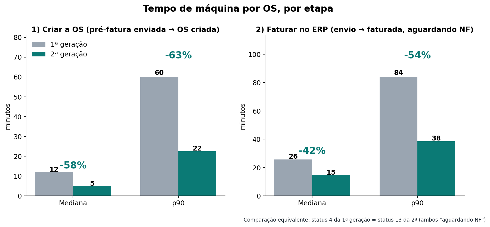

> **O que é o p90:** é o tempo dentro do qual 90% das OS ficam prontas; só 10% demoram mais que isso. Mostra o "pior caso comum", sem o peso de um ou outro caso extremo. Na criação da OS, 90% passaram a ficar prontas em até 22 min (antes, 60 min).

> **Como ler:** a 2ª geração é mais rápida nas duas etapas de máquina, **criar a OS (−58%)** e **faturar no ERP (−42% na mediana)**, e o volume de OS válidas ficou estável (cerca de 1.800 por mês), então o ganho não vem de "menos trabalho". A única piora está na cauda de faturar (mais de 6 h), e ela vem inteira de um episódio de e-mail ausente no cadastro dos clientes em nov/2026 (seção 4.6). O outro grande ganho é de **confiabilidade**: cada passo tem estado e log, e as alterações sem log foram de ~37% das OS para ~0%.

---

## 1. O problema

O processo de faturamento tinha quatro dores:

1. **Fila opaca.** Quando uma OS falhava, não havia estado que dissesse em qual etapa ela havia parado. Descobrir exigia investigar o banco de dados e o ERP.
2. **Intervenção manual.** Falhas eram corrigidas à mão, direto no banco e no ERP, com risco de erro em dado financeiro.
3. **Duração imprevisível.** Havia ciclos que levavam dias para terminar, o que impedia planejar o fechamento do mês.
4. **Retrabalho e duplicidade.** O robô não checava se a OS já existia antes de criá-la, e dados inválidos (tamanho de campo, CPF/CNPJ) só eram rejeitados pelo ERP, depois do envio.

Por ser receita, qualquer atraso ou erro tem custo direto.

---

## 2. O que foi entregue

Foram **253 commits** nos arquivos do módulo (robôs, services, jobs, models, controllers e a classe de integração com o ERP), entre 03/09/2024 e 20/10/2026: 133 de `feature`, 51 de `fix`/`hotfix`, 11 de `refactor` e 27 merges de pull request. Cerca de 79% citam a task de origem. **231 já estão na branch principal (produção)** e 22 estão na branch de testes, ainda não mergeada.

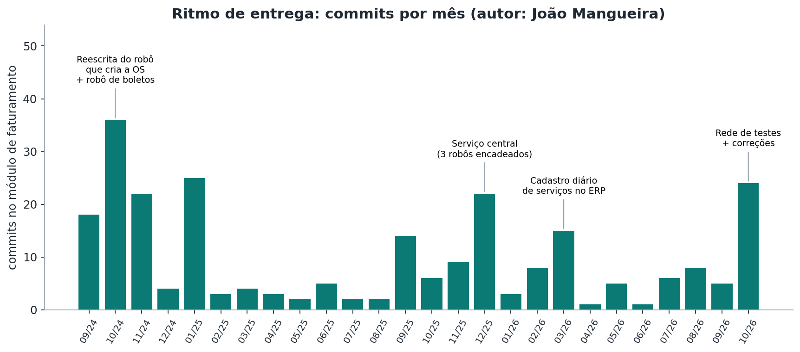

### Linha do tempo

| Quando | Entrega |
|---|---|
| ago/2024 | Correções emergenciais no robô de faturamento (clientes que não eram guardados, empresa sem CNPJ no ERP, `try/catch` para o robô não parar). |
| set/2024 | Primeira refatoração do financeiro: método para customizar o `update` e gravar log "de/para"; ajustes para os robôs não quebrarem com listas vazias. |
| out/2024 | **Reescrita do robô que cria a OS:** checagem de OS já existente antes de criar, validação de tamanho de campos e de CPF/CNPJ e tratamento dos erros devolvidos pelo ERP. |
| out/2024 | Nova forma de dividir as notas (faturamento fracionado) e mensagens de erro claras ao cancelar. |
| out/2024 | **Robô que concilia os boletos:** grava e atualiza o status dos boletos e os concilia com a OS (23 commits de evolução). |
| nov/2024 a jan/2025 | Edição de itens da fatura (desconto, acréscimo, quantidade) com validação no back; robô de OS avulsa passa a gravar no banco e a registrar logs. |
| set/2025 | Troca de data de vencimento da nota pelo painel, com log. |
| **dez/2025** | **Serviço central de faturamento: centraliza o processo, com três robôs encadeados (robô que cria a OS, robô que envia para faturar, robô que sincroniza a OS faturada) e cada transição de estado auditada.** |
| fev/2026 | Reprocessamento de OS com status de falha, direto pela tela. |
| mar–mai/2026 | Cadastro diário automático dos serviços no ERP e mensageria para trocar o nome do serviço na OS sem duplicar notas. |
| jul/2026 | Pré-faturas por robô, sem fila, com frequências diferentes, filtro por cliente e proteção contra duplicadas. |
| ago/2026 | Clientes do exterior (sem CNPJ) aceitos pelo ERP; faturamento de contratos recorrentes conforme o mês de pagamento; OS agendada. |
| out/2026 | **Rede de testes sobre o módulo** e correções de bugs de legado e de segurança achados por ela (seção 8). |

---

## 3. A arquitetura: um robô por etapa, estado em cada passo

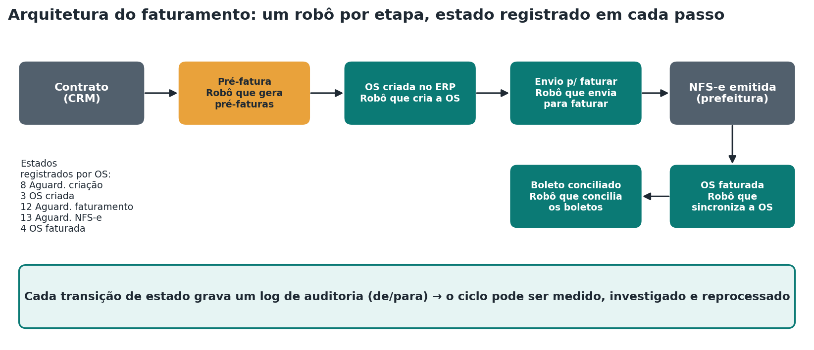

Na 2ª geração, cada etapa é um robô com **entrada e saída bem definidas**:

| Etapa | Robô | Estado da OS ao terminar |
|---|---|---|
| Gera pré-faturas | robô que gera pré-faturas | 8 · Aguardando criação da OS |
| Cria a OS no ERP | robô que cria a OS | 3 · OS criada |
| Envia para faturar e pede a NFS-e | robô que envia para faturar | 12 · Aguardando faturamento → 13 · Aguardando NFS-e |
| Sincroniza o resultado | robô que sincroniza a OS faturada | 4 · OS faturada |
| Concilia o boleto | robô que concilia os boletos | título RECEBIDO / A VENCER / ATRASADO |

O serviço central de faturamento (cerca de 2,4 mil linhas) concentra as regras; os robôs ficam finos (de 70 a 100 linhas cada). Toda mudança de estado passa por **um único ponto**, um método único de transição, que decide se o resultado é sucesso ou erro, registra a falha no robô e grava o log "de/para" com o nome do robô responsável (pseudocódigo):

```text
atualizar_status(os, novo_status, mensagem):
    se novo_status é de erro: registrar a falha no robô
    gravar na OS: { status, mensagem de erro,
                    atualizado_por = usuário-robô,   # quem agiu foi o robô, não uma pessoa
                    atualizado_em  = agora }
    gravar log "de/para" com a descrição "<status> [<robô responsável>]"
```

Cada linha dessas vira um registro de auditoria. Um exemplo, simplificado, do que a produção guarda para cada OS:

```text
Fatura - OS criada               [robô que cria a OS]               status 8 → 3
Fatura - Aguardando faturamento  [robô que envia para faturar]      status 3 → 12
Fatura - Aguardando número NFS-e [robô que envia para faturar]      status 12 → 13
Fatura - OS faturada             [robô que sincroniza a OS faturada] status 13 → 4
```

Também ficou fácil operar: um robô de pré-faturas roda sem fila, para um cliente, uma data ou uma lista de clientes, e pode ser reexecutado com segurança, porque tem proteção contra duplicadas:

```text
# Exemplo ilustrativo: gerar pré-faturas de um cliente, em uma data, sem passar pela fila
executar robô-que-gera-pré-faturas --data=01/10/2025 --cliente=<id-do-cliente>
```

---

## 4. Resultado medido nos logs de produção

### O ciclo tem três trechos, e um deles é humano

Nos dias de faturamento (01 e 20), o financeiro envia as OS para processamento. A 2ª geração gera as OS antes e só fatura no dia, então o tempo entre "OS criada" e "enviada para processamento" cresceu de propósito. Esse passo (status 3→9) é feito por **pessoas**, em horário comercial, nas duas gerações. Medir "pré-fatura até faturada" de ponta a ponta misturaria o sistema com a rotina do financeiro, e o total pareceria pior (mediana de 2,4 h na 1ª geração contra 15,6 h na 2ª) sem que isso tenha a ver com a qualidade do processo.

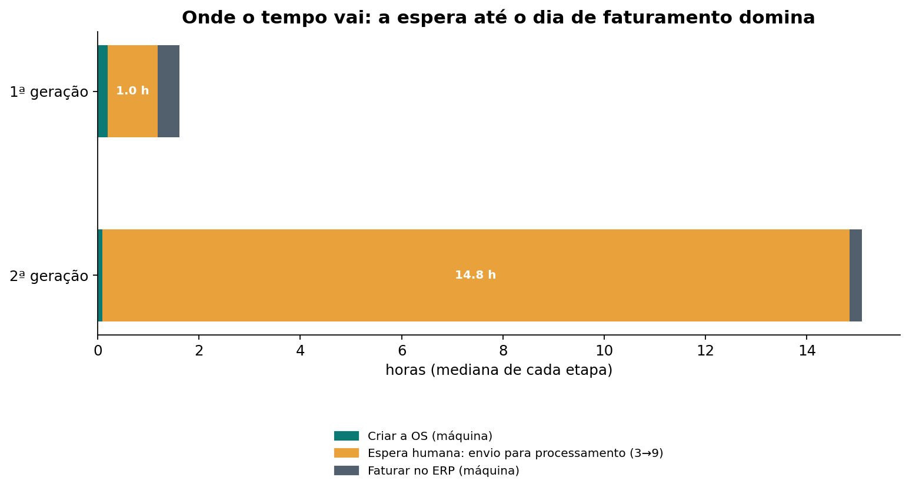

Por isso o estudo mede **cada trecho de máquina separadamente** e deixa a espera humana de fora:

| Trecho | Quem executa | 1ª geração (mediana) | 2ª geração (mediana) |
|---|---|---|---|
| Criar a OS (8→3) | robô | 12 min | 5 min |
| Envio para processamento (3→9) | pessoa | 1,0 h | 14,8 h |
| Faturar no ERP (9→4 na 1ª geração, 9→13 na 2ª) | robô | 26 min | 15 min |

### Método

Só usei **carimbos de tempo dos logs** (tabela de logs, filtrando os eventos de OS), sem instrumentação nova, e retirei as OS geradas por engano (status 1→6, seção 5).

* **1ª geração:** 17/09/2024 a 17/12/2025. **2ª geração (serviço central de faturamento):** 18/12/2025 a 11/11/2026.
* Os logs da 1ª geração agrupam várias OS em um registro, e o parser separa uma a uma pelos identificadores.

### 4.1 Criar a OS: do envio da pré-fatura até a OS criada

Amostra: 25.531 OS (1ª geração) e 20.044 OS (2ª geração).

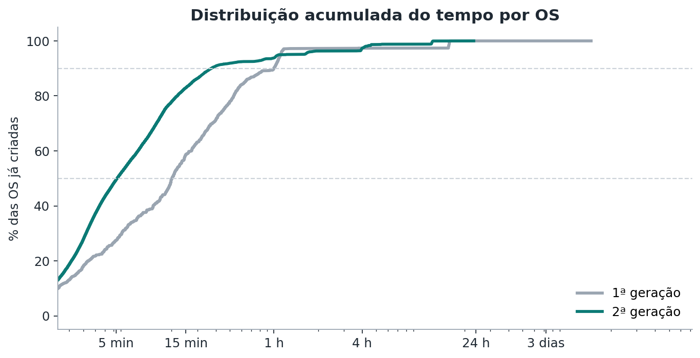

**Metade das OS fica pronta em 5 minutos** (12 na 1ª geração), e 90% em 22 minutos (60 antes). As curvas se cruzam perto de 1 a 2 horas, o que é esperado, porque a 2ª geração não elimina OS lentas que dependem de resposta do ERP. O que mudou é o **teto**: a pior OS passou de 146,8 h para 23,2 h, e o percentil 99 foi de 15,7 h para 11,9 h.

Nos dias com 500 ou mais OS, o ciclo inteiro (da primeira pré-fatura até a última OS criada) tinha **mediana de 7,6 h na 1ª geração e 7,7 h na 2ª**, o que é equivalente:

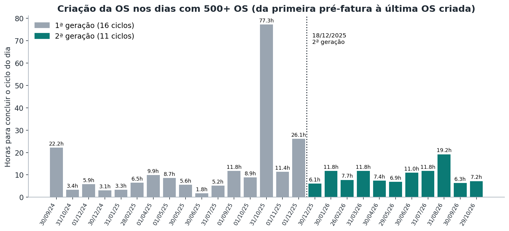

| Dias com 500+ OS | 1ª geração | 2ª geração |
|---|---|---|
| Ciclos | 16 | 11 |
| Média | 13,2 h | 9,7 h |
| Pior ciclo | 77,3 h | 19,2 h |
| Ciclos acima de 24 h | 2 | 0 |

A amostra é pequena (27 dias), então o resultado indica uma tendência, mas não é conclusivo.

### 4.2 Faturar: do envio para processamento até a OS faturada no ERP

**O status 4 não significava a mesma coisa nas duas gerações.** Na 1ª geração, depois que o ERP aceitava o faturamento, o robô gravava `status = 4` com o comentário "aguardando número da NF" no código, e o número da NFS-e só era preenchido depois, por outro robô (ou no caminho de recuperação, quando a OS já estava faturada). Na 2ª geração, esse mesmo momento é o **status 13 (aguardando NFS-e)**, e o 4 só vem quando a NF está preenchida. Por isso a comparação equivalente é: **status 4 da 1ª geração × status 13 da 2ª**.

| Envio → faturada no ERP (aguardando NF) | 1ª geração | 2ª geração |
|---|---|---|
| Mediana por OS | 25,7 min | **14,8 min (−42%)** |
| p90 por OS | 83,8 min | **38,5 min (−54%)** |
| OS acima de 1 h | 23,4% | **2,5%** |
| p99 por OS | 3,3 h | 7,2 h |
| OS acima de 6 h | 0,14% | 1,3% |
| 95% do lote do dia 01 faturado em (mediana) | 3,5 h | **2,9 h** |
| Lote completo do dia 01 (mediana) | 7,3 h | 7,7 h |

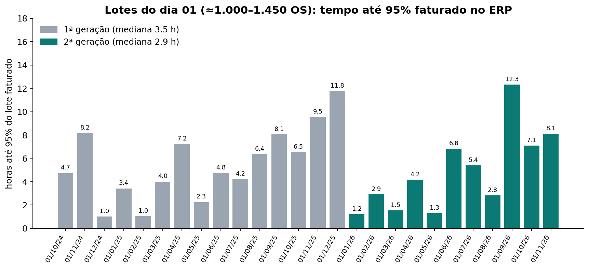

A 2ª geração é mais rápida no caso típico e no p90. As duas medidas em que ela aparece pior (p99 e OS acima de 6 h) vêm de um único episódio: **251 das 257 OS acima de 6 h na 2ª geração são de nov/2026**, o episódio de e-mail ausente no cadastro dos clientes (seção 4.6). Sem ele, a fatia acima de 6 h cai para cerca de 0,03%, abaixo da 1ª geração. Um lote do dia 01 reúne de 1.000 a 1.450 OS; o pior lote da 2ª geração (12,3 h, em 01/09/2026) mostra que a variação entre lotes continua grande.

### 4.3 A emissão da nota (NF) na 2ª geração

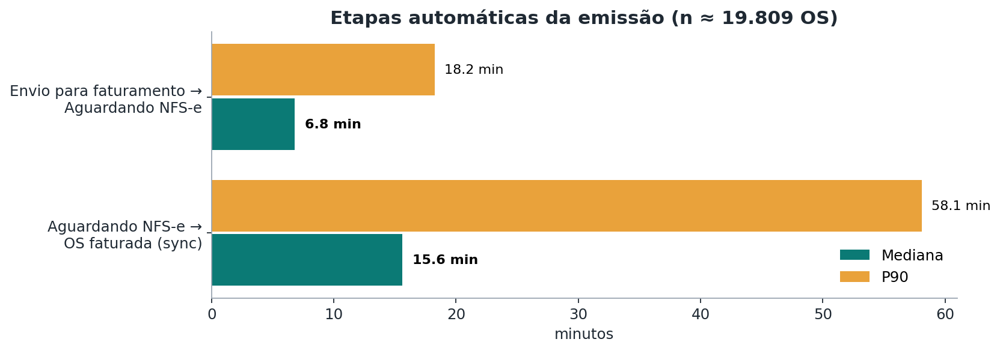

Depois do status 13, a etapa até a OS faturada com NF preenchida leva **cerca de 15,6 minutos na mediana** (p90 de 58 min). No total, do envio para faturar até a NF emitida são **cerca de 28 minutos na mediana**, com 90% das OS em até 74 minutos. O tempo depende da prefeitura, não só do sistema. Esse trecho **só é medido na 2ª geração**: na 1ª, o preenchimento da NF não gerava log, então não há como medir o mesmo intervalo.

### 4.4 Conciliação automática de boletos

O robô que concilia os boletos roda toda madrugada e compara os títulos do ERP com as OS do banco:

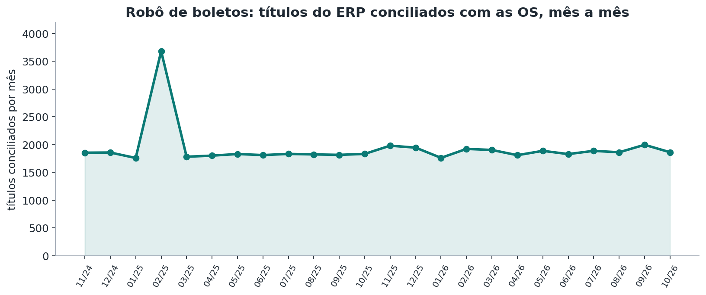

* **163,6 mil títulos** conciliados desde out/2024 (a carga inicial foi de 115,7 mil; depois, cerca de 1,8 a 2 mil por mês).
* **97%** estão como RECEBIDO; os demais ficam em A VENCER, VENCE HOJE, ATRASADO ou CANCELADO, atualizados pelo robô.
* Cada mudança de status automática grava log com a descrição "Alterado pelo robô de conciliação de boletos": **10 mil alterações** registradas e auditáveis.

### 4.5 Falhas visíveis e reprocessáveis

Na 2ª geração, toda falha tem um **estado próprio** (erro ao criar, ao faturar, após criar, após faturar, ao alterar banco, ao cancelar). Em 11 meses e 20 mil OS, foram cerca de 530 eventos de erro (2,6%), cada um com mensagem, etapa e robô responsável, e a tela passou a permitir **reprocessar** a OS com falha (fev/2026), sem mexer no banco. A maior parte desses eventos está em dois episódios de causa externa (seção 4.6).

### 4.6 Os picos da 2ª geração: causas externas ao processo

Os piores momentos da 2ª geração vieram de **mudanças e instabilidades externas**, e não de falha de lógica do processo. Os logs confirmam o mês, o tipo de falha e o efeito no tempo de cada episódio:

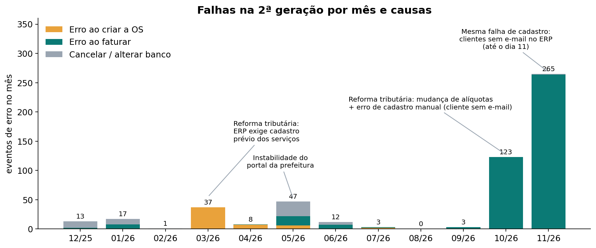

| Episódio | Causa | O que os logs mostram |
|---|---|---|
| **mar/2026** | Reforma tributária: o ERP passou a exigir que os serviços fossem cadastrados nele antes de gerar a OS, e o sistema ainda não estava preparado para essa mudança. A criação das OS falhou e demorou mais. | 37 erros ao criar a OS no mês (de 0 a 7 nos demais) e p90 de criação de 59 min (de 10 a 27 min nos meses normais). |
| **mai/2026** | Instabilidade do portal da prefeitura, que atrasou a emissão das notas. | 47 eventos de erro; p90 de faturar de 295 min e mediana de 89 min, contra ~40 min nos meses normais. |
| **out/2026** | Reforma tributária: mudaram as alíquotas dos tributos, e houve **erro de cadastro manual** (clientes cadastrados sem e-mail no ERP), e não do sistema. O ERP recusa faturar sem e-mail. | 117 erros de "falta preencher o E-mail" em out (de 123 erros ao faturar), contra 0 em todos os meses anteriores. Os picos caem nos lotes de 20/10 (96 erros) e em alguns dias isolados antes disso. |
| **nov/2026** | Mesma falha de cadastro: clientes sem e-mail no ERP. | 263 erros de e-mail em 01/11 (dados até o dia 11) e p90 de faturar de 436 min. |

**A falha de e-mail do cadastro (out e nov) foi corrigida de forma automática.** Em 20/10/2026, o sistema passou a tratar o caso: quando o ERP recusa por falta de e-mail, ele busca o e-mail no CRM, atualiza o cadastro do cliente no ERP, aguarda o ERP refletir a mudança e refatura. Mesmo assim, 263 OS falharam na primeira passada do lote de 01/11, mas o robô as resolveu sozinho na passada seguinte: **325 das 326 OS afetadas foram faturadas, em cerca de 7 h no máximo (mediana de 6,6 h)**, sem intervenção manual. Esse atraso de ~7 h é o que explica o p90 de faturar de 436 min em nov.

**Os episódios de mar/2026 e out–nov/2026 (reforma tributária e falha de cadastro) somam 425 dos 529 eventos de erro da 2ª geração (80%).** Fora deles e de mai/2026, restam cerca de 60 eventos em 8 meses, bem menos de 1% das 20 mil OS. Como cada falha tem estado próprio, é possível saber quais OS foram afetadas e reprocessá-las pela tela, sem investigar no banco.

O módulo recebeu ainda entregas ligadas à reforma tributária: em mar/2026, o robô que cadastra diariamente os serviços no ERP e a OS pontual da reforma; em set/2026, o endpoint e a regra de tributação (retém/destaca) da OS.

> **Nota de método:** as causas de mar/2026 (exigência do ERP), mai/2026 (portal da prefeitura) e out/2026 (mudança de alíquotas somada a erro de cadastro manual) vêm do autor. Os logs confirmam o momento, o tipo de falha (e-mail ausente em out–nov) e o efeito no tempo, mas não registram o motivo de cada episódio. A explicação do que fez a primeira passada do lote de 01/11 falhar mesmo com a correção ativa (provavelmente o atraso do ERP em refletir o e-mail) é uma inferência.

---

## 5. Volume de OS e qualidade da geração

O volume mensal de OS parece crescer em 2026, mas isso é efeito de **OS geradas por engano**. Usando o log como instrumento, identifiquei as **11.142 OS** cujo status foi de 1 (pré-fatura) direto para 6 (cancelada), ou seja, nasceram e foram canceladas sem nunca virar OS no ERP.

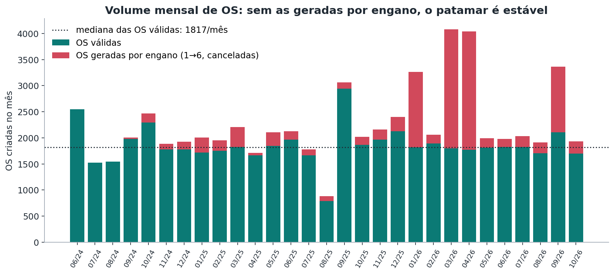

| Período | Média mensal (OS totais) | Média mensal (OS válidas) |
|---|---|---|
| jan–ago/2024 | 1.901 | 1.901 |
| set–dez/2024 | 2.070 | 1.956 |
| 2025 | 2.035 | 1.844 |
| 2026 (jan–out) | 2.664 | 1.826 |

Sem as OS erradas, o volume é **estável, perto de 1.800 por mês**, e a mediana de 2026 (1.816) é igual à de 2025 (1.838). Os meses de jan, mar, abr e set/2026, que pareciam picos, tinham de 37% a 56% de OS erradas.

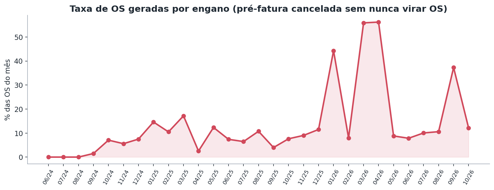

Em um mês normal, **6% a 12% das OS nascem erradas**. Esse indicador não existia antes dos logs de transição e passa a ser uma métrica de qualidade acompanhável.

> **Limite importante:** os 6% a 12% são um **piso**. Antes do controle por status, OS erradas eram excluídas do banco, e os logs só registram transições a partir de set/2024. O número real da época provavelmente era maior.

---

## 6. Cobertura de auditoria: alterações sem log

Se todo registro é auditável, cada mudança na OS deveria ter um log correspondente. Medi o contrário: para cada OS criada desde 17/09/2024 (**59.111 OS**), comparei o `updated_at` da tabela com o horário do último log dela, e o status atual com a última transição de status registrada. Uma OS foi marcada quando foi alterada mais de 10 minutos depois do último log, quando o status atual diverge da última transição logada, ou quando não tem log nenhum.

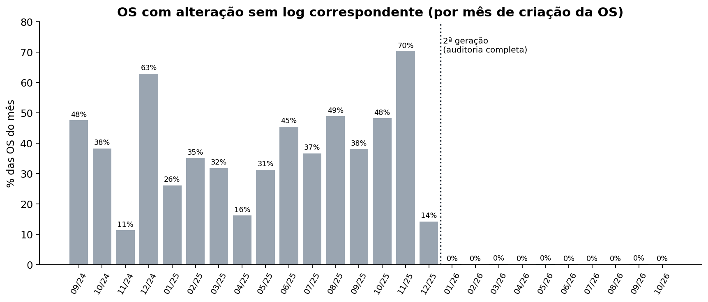

| Período | OS com alteração sem log |
|---|---|
| set/2024 a dez/2025 (1ª geração) | de 11% a 70% das OS por mês (mediana ~37%) |
| jan/2026 em diante (2ª geração) | **0% a 0,2%** (19 OS em 10 meses) |
| Total desde set/2024 | 11.999 OS (20,3%), 714 delas sem nenhum log |

O que os dados mostram sobre essas alterações:

* **Foram escritas pelo sistema, e não por pessoas.** Todas têm `updated_by` igual ao usuário-robô.
* **Quase todas são OS faturadas** (99,9%): o passo final da 1ª geração gravava a OS sem registrar o log correspondente. O código da época confirma: tanto o robô que envia para faturar quanto o robô que sincroniza a OS faturada gravavam a OS com um UPDATE direto no banco, sem log. Em 68% dos casos o intervalo foi de até 1 hora, e em 11% passou de 7 dias.
* **O fim do problema coincide com o serviço central de faturamento:** como toda transição passa pelo método único de transição, que grava o log, a lacuna fechou. Nov/2025 (70%) e dez/2025 (14%) são os meses de transição, quando os dois fluxos conviveram.
* **Os 714 sem log nenhum** são de set e out/2024, no início da instrumentação.

Isso transforma a "auditoria completa" de afirmação em número: **de cerca de 1 em cada 3 OS (37% na mediana) com lacuna no histórico para praticamente nenhuma**.

> **Limite:** o método só enxerga alterações que atualizam o `updated_at`. Uma edição manual direta no banco que não mexa nesse campo não aparece. Por isso o número da 1ª geração é um **piso**.

---

## 7. Como era antes: o que os dados permitem dizer

Os logs de transição por OS só existem a partir de 17/09/2024, e a refatoração começou em 03/09/2024. Por isso **não há tempo medido para o processo original**, e este estudo não inventa um. O que o histórico mostra:

* **ago/2024:** commits de correção direto no robô (clientes que não eram guardados, empresa sem CNPJ cadastrado no ERP, `try/catch` para o robô não parar de vez).
* **set/2024:** correção de robôs que quebravam com listas vazias (`foreach` sobre resultado vazio).
* **out/2024:** 722 das 2.466 OS do mês (29%) ficaram com mensagem de erro gravada no próprio registro. Esse número é o estado atual da tabela, então é só um indício do volume de falhas da época.
* **Mar a set/2024:** os logs de faturamento são poucos e sem estado por OS (cerca de 1,4 mil registros de "enviadas para faturamento").

Para provar o ganho sobre o processo original, o melhor caminho é combinar esses indícios com o relato da operação (quantas intervenções manuais por mês, quantos dias o fechamento levava).

---

## 8. Por que melhorou e por que foi importante

**Por que melhorou**

1. **Uma responsabilidade por robô.** Se uma OS falha, o estado registrado diz em qual etapa ela parou, sem investigar o banco ou o ERP.
2. **Validar antes de enviar.** A checagem de OS já existente e a validação de tamanho de campos e CPF/CNPJ evitam retrabalho e notas duplicadas.
3. **Ponto único de transição.** Um único método muda o status e grava a auditoria, de modo que nenhuma etapa fica sem rastro.
4. **Operação segura.** Robôs reexecutáveis, com filtros e proteção contra duplicadas, trocam o "conserta no banco" por um comando.

**Por que foi importante**

* **Receita previsível.** Um ciclo sem casos extremos permite planejar o fechamento do mês.
* **Menos intervenção manual** no banco e no ERP, e menos risco sobre dados financeiros.
* **Auditoria e ISO.** Cada transição tem autor (pessoa ou robô), horário, valor anterior e valor novo, o que serve como evidência pronta.
* **Medível.** O ganho só pôde ser provado porque o projeto de logs registra cada transição: este estudo foi montado só com esses carimbos.

### Testes sobre o módulo

Em out/2026, cobri o módulo com testes automáticos (sem criar camadas novas: dependências pelo construtor, regras em funções puras e `Carbon::now()` no lugar de `date()`):

| Item | Cobertura |
|---|---|
| robô que cria a OS, robô que envia para faturar, robô que sincroniza a OS faturada, robô de sincronização de faturas, robô de OS avulsa, robô de cadastro de serviços no ERP | 100% |
| robô que concilia os boletos | 99,3% |
| serviço de regras da OS | 97,1% |
| divisão proporcional de valor | 100% (e 100% dos mutantes mortos no Infection) |
| Testes do módulo (services, robôs e telas) | cerca de 550 |

Esses testes acharam defeitos que estavam em produção. No faturamento, a divisão proporcional de valores dava **divisão por zero** quando os itens somavam zero, e o job de anexar nota manual **nunca chegava ao fim**. Também foi corrigida uma **injeção de SQL** nos filtros de mês/ano.

> Nota: os testes vivem em uma branch de testes, ainda não mergeada. O código do serviço central de faturamento em produção é o da branch principal.

---

## 9. Limites e transparência

* **Baseline.** A comparação é entre a 1ª e a 2ª geração. Não há medida de tempo para o processo anterior a set/2024 (seção 7).
* **Lacunas de log.** Só detecta alterações que atualizam o `updated_at` (seção 6).
* **Períodos.** 1ª geração: 17/09/2024 a 17/12/2025. 2ª geração: 18/12/2025 a 11/11/2026.
* **Medida.** O estudo mede só tempo de máquina: criar a OS (8→3) e faturar no ERP (9→4 na 1ª geração e 9→13 na 2ª). A espera humana (3→9) e a data agendada de faturamento ficam de fora, e o total ponta a ponta não é comparável entre as gerações.
* **Faturar no ERP.** A comparação usa o status 4 da 1ª geração e o status 13 da 2ª, que representam o mesmo momento ("aguardando NF"), conforme o código da época. O trecho final (preenchimento da NF) só é medido na 2ª geração, porque na 1ª ele não gerava log.
* **Causas dos picos.** As causas dos picos de mar/2026, mai/2026 e out–nov/2026 vêm do autor; os logs confirmam o mês e o tipo de falha (em out–nov, e-mail ausente no cadastro), mas não o motivo de cada episódio. Para out/2026, os logs não registram nenhuma falha de alíquota; só a de e-mail.
* **Casos de dias.** Na criação da OS, a 1ª geração teve OS de até 6 dias e 2 ciclos acima de 24 h, e a 2ª geração não teve nenhum. Na etapa de faturar, a memória da operação indica atrasos de dias na 1ª geração, mas os logs não permitem provar isso com segurança.
* **Mediana dos fechamentos.** Equivalente nas duas gerações (7,6 h e 7,7 h). O benefício está nos extremos e na previsibilidade, e este documento não alega melhora no caso típico de fechamento. A amostra é de 27 dias.
* **OS erradas.** A detecção usa a transição de status 1 → 6 registrada em log. É um piso: OS excluídas do banco e eventos anteriores a set/2024 não aparecem. Um cancelamento legítimo antes de faturar também cairia no filtro.
* **Amostra de tempo.** Só entram OS com início e fim registrados (25,5 mil de 30,4 mil na 1ª geração e 20 mil de 28,7 mil na 2ª). As OS que não chegaram a "OS criada" (canceladas, com erro ou ainda em processamento) ficam de fora dos tempos.
* **Privacidade.** Contagens agregadas e carimbos de tempo; sem nomes, valores, documentos ou identificadores de clientes.

---

### Metodologia reprodutível

1. Exportar da tabela de logs os eventos de início e de fim por OS (filtro pelos eventos de OS e pela mensagem do estado).
2. Separar os identificadores múltiplos (`identifier`) e parear início e fim por OS.
3. Calcular mediana, p90, p99, máximo e a duração do ciclo por dia (da primeira pré-fatura à última OS criada).
4. Identificar OS erradas: logs de `status` com valor antigo 1 e novo 6; retirar da contagem de volume.
5. Faturar no ERP: início no log do status 9, fim no log do status 4 (1ª geração) ou do status 13 (2ª geração), que são o mesmo momento ("aguardando NF"). Lotes: dias com 200+ OS.
6. Lacunas de log: comparar o `updated_at` da OS com o último log dela (excluindo os logs de títulos, que reutilizam o mesmo identificador de tabela) e o status atual com a última transição numérica.
7. Commits: `git log --author=... -- <arquivos do módulo>`, desde 03/09/2024.

*Estudo de caso de João Mangueira · Fonte: histórico git e logs do painel interno.*
